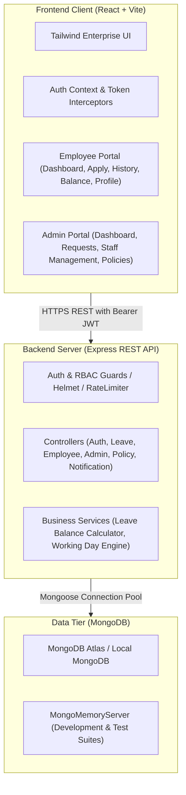

# Leave Management System (LMS) – MERN Stack

A modern, production-grade enterprise Leave Management System engineered using the **MERN** stack (MongoDB, Express.js, React 18, Node.js). Designed for corporate organizations to streamline employee leave applications, quota tracking, role-based workflows, and automated administrator approvals.

---

## 1. Executive Project Overview

Managing employee time-off, statutory leave entitlements, and company-specific quota rules using manual emails or spreadsheets leads to error-prone balance calculations, unmonitored absenteeism, and compliance bottlenecks. 

The **Leave Management System (LMS)** centralizes the complete employee absence lifecycle into a secure, responsive, and auditable web portal. The system enforces strict business logic:
- Real-time leave balance deduction and overbooking protection.
- Automated weekend exclusion when calculating working days.
- Independent balance tracking across leave categories (Casual, Sick, and Earned Leave).
- Role-based separation of concerns between standard Employees and HR Administrators.

---

## 2. Technology Stack

| Layer | Technology | Version | Purpose |
| :--- | :--- | :--- | :--- |
| **Frontend UI** | React.js | `18.3.1` | Component-based interactive user interface |
| **Build Tool** | Vite | `6.1.0` | Ultra-fast HMR and optimized production bundling |
| **Styling** | Tailwind CSS | `3.4.17` | Utility-first responsive enterprise styling |
| **Routing** | React Router DOM | `7.1.5` | Client-side routing with protected and role-based guards |
| **State & Auth** | Context API & LocalStorage | Built-in | Global session management, reactive state updates |
| **Form Management**| React Hook Form & Zod | `7.54` / `3.24`| Schema validation, form state control, and error handling |
| **Charts & Visuals** | Recharts | `2.15.1` | Workforce analytics, leave distribution & monthly trends |
| **Icons** | Lucide React | `0.475.0` | Clean, modern iconography |
| **Notifications** | React Hot Toast | `2.5.2` | Non-blocking user feedback & action status toasts |
| **Backend API** | Node.js & Express.js | `4.21.2` | RESTful API server with MVC architecture |
| **Database** | MongoDB & Mongoose | `8.10.1` | Document database with schema indexing & in-memory fallback |
| **Security** | Helmet, bcryptjs, JWT, Rate-Limit | `8.1` / `3.0` | Secure HTTP headers, password hashing, rate limiting |
| **Testing** | Jest, Supertest, Vitest, RTL | `29.7` / `3.0` | Automated unit, integration, and API test coverage |

---

## 3. High-Level Architecture Overview



---

## 4. Key Functional Features

### 4.1 Employee Self-Service Module
- **Intuitive Dashboard**: Overview cards with total quota, used days, remaining balance, pending reviews, and dynamic status distribution charts.
- **Leave Application Engine**:
  - Live automatic working-day counter that excludes Saturdays and Sundays.
  - Strict validation preventing past start dates and inverted date ranges.
  - Live available quota verification preventing overbooking before submission.
  - Overlap check preventing duplicate filings for identical calendar dates.
  - Document attachment upload (PDF, DOC, DOCX, PNG, JPG) with 5MB cap.
- **Leave History & Tracking**:
  - Filter by status (`Pending`, `Approved`, `Rejected`, `Cancelled`).
  - Search by reason or administrator remarks.
  - Pagination and instant cancellation of pending applications.
- **Quota Breakdown**:
  - Detailed balance metrics for Casual Leave (6d), Sick Leave (6d), and Earned Leave (12d).
  - Visualization meters displaying utilized vs available balances.
- **Profile & Security**: Update profile name and self-service password changes.

### 4.2 Administrator Management Module
- **Executive HR Dashboard**: Real-time stats for total employees, active staff, total leaves filed, pending approval queue, and employees absent today.
- **Request Review System**:
  - Comprehensive filters by department, leave category, status, and dates.
  - Modal viewing employee information, past leaves, and supporting documents.
  - Atomic approval verifying remaining balance before committing approval.
  - Mandatory rejection reason recording.
  - In-app notification delivery to employees upon status decision.
- **Staff Provisioning & Management**:
  - Create new employee profiles with unique Employee ID and email verification.
  - Edit employee details (department, designation, role).
  - Account deactivation (soft toggle preventing deletion of historical records).
  - Superuser password reset functionality.
- **Leave Policy Administration**: Live configuration of annual allocations per leave category and attachment mandate enforcement.

---

## 5. Repository Structure

```text
Leave Management System/
├── backend/
│   ├── config/
│   │   └── db.js                    # Database connection with MongoMemoryServer fallback
│   ├── controllers/
│   │   ├── adminController.js       # Executive stats, approvals, employee CRUD
│   │   ├── authController.js        # Login, logout, session check, password change
│   │   ├── employeeController.js    # Profile & self-service balance endpoints
│   │   ├── leaveController.js       # Leave application, cancellation, history
│   │   ├── notificationController.js# In-app notifications
│   │   └── policyController.js      # Leave policy configuration
│   ├── middleware/
│   │   ├── authMiddleware.js        # JWT extraction & active user validation
│   │   ├── errorMiddleware.js       # Centralized 404 & error formatting
│   │   ├── roleMiddleware.js        # RBAC role authorization
│   │   ├── uploadMiddleware.js      # Multer file storage & type filtering
│   │   └── validationMiddleware.js  # Zod schema request validation
│   ├── models/
│   │   ├── Leave.js                 # Leave request schema with indexes
│   │   ├── LeavePolicy.js           # Yearly policy allocation schema
│   │   ├── Notification.js          # In-app notification schema
│   │   └── User.js                  # User schema with bcrypt hashing
│   ├── routes/
│   │   ├── adminRoutes.js           # /api/admin/*
│   │   ├── authRoutes.js            # /api/auth/*
│   │   ├── employeeRoutes.js        # /api/employees/*
│   │   ├── leaveRoutes.js           # /api/leaves/*
│   │   ├── notificationRoutes.js    # /api/notifications/*
│   │   └── policyRoutes.js          # /api/policies/*
│   ├── scripts/
│   │   └── seedAdmin.js             # Idempotent database seeder
│   ├── services/
│   │   ├── leaveService.js          # Working days, overlap, balance calculation
│   │   └── notificationService.js   # Automated user & admin notifications
│   ├── tests/
│   │   └── api.test.js              # 20 automated integration tests (Supertest + Jest)
│   ├── validators/
│   │   └── schemas.js               # Zod validation schemas
│   ├── .env.example
│   ├── package.json
│   └── server.js                    # Express application entrypoint
├── docs/
│   ├── BRD.md                       # Comprehensive Business Requirements Document
│   └── TESTING.md                   # Quality Assurance & Test Execution Report
├── frontend/
│   ├── public/
│   ├── src/
│   │   ├── components/
│   │   │   ├── common/              # Badge, Modal, ConfirmDialog, StatCard, NotificationDropdown
│   │   │   └── layout/              # Navbar, Sidebar, DashboardLayout
│   │   ├── context/
│   │   │   └── AuthContext.jsx      # Session provider & authentication state
│   │   ├── pages/
│   │   │   ├── admin/               # Dashboard, LeaveRequests, Employees, Policy, Profile
│   │   │   ├── auth/                # LoginPage
│   │   │   └── employee/            # Dashboard, ApplyLeave, LeaveHistory, LeaveBalance, Profile
│   │   ├── routes/                  # ProtectedRoute, RoleBasedRoute
│   │   ├── services/                # Axios API instances & service modules
│   │   ├── test/                    # RTL & Vitest test suites
│   │   ├── App.jsx                  # Main application router
│   │   ├── index.css                # Tailwind CSS imports
│   │   └── main.jsx                 # React root renderer
│   ├── .env.example
│   ├── index.html
│   ├── package.json
│   ├── tailwind.config.js
│   └── vite.config.js
├── .gitignore
├── package.json                     # Root orchestrator scripts
└── README.md
```

---

## 6. Local Setup and Installation

### Prerequisites
- **Node.js**: v18.x, v20.x, or v22+ (verified on Node v25.2.0)
- **npm**: v9.x or v10+
- **MongoDB**: Local MongoDB instance (default: `mongodb://localhost:27017/leave_management`) or MongoDB Atlas URI. *(Note: Backend includes automatic in-memory fallback for development and testing if local mongod is not installed).*

### Step-by-Step Installation

1. **Clone the repository**:
   ```bash
   git clone <repository_url>
   cd "Leave Management System"
   ```

2. **Install all dependencies (Root, Backend, and Frontend)**:
   ```bash
   npm run install:all
   ```

3. **Configure Environment Variables**:
   Copy the example environment files into place:
   ```bash
   # Backend
   cp backend/.env.example backend/.env

   # Frontend
   cp frontend/.env.example frontend/.env
   ```

   *Backend `.env` options:*
   ```env
   PORT=5000
   NODE_ENV=development
   MONGODB_URI=mongodb://localhost:27017/leave_management
   JWT_SECRET=production_quality_jwt_secret_key_leave_management_2026_secure_random
   JWT_EXPIRES_IN=1d
   CLIENT_URL=http://localhost:5173
   ADMIN_NAME=System Administrator
   ADMIN_EMAIL=admin@example.com
   ADMIN_PASSWORD=Admin@123456
   ```

   *Frontend `.env` options:*
   ```env
   VITE_API_BASE_URL=/api
   ```

4. **Seed Initial Database (Admin, Policies, and Sample Staff)**:
   ```bash
   npm run seed
   ```

   *Default Seed Credentials:*
   | Role | Email | Password |
   | :--- | :--- | :--- |
   | **System Administrator** | `admin@example.com` | `Admin@123456` |
   | **Staff Engineer** | `sarah.connor@example.com` | `Employee@123` |
   | **Sales Manager** | `michael.scott@example.com` | `Employee@123` |
   | **HR Coordinator** | `pam.beesly@example.com` | `Employee@123` |

5. **Start Development Servers**:
   - Backend API (`http://localhost:5000`):
     ```bash
     npm run dev:backend
     ```
   - Frontend Portal (`http://localhost:5173`):
     ```bash
     npm run dev:frontend
     ```

---

## 7. Testing Suite Execution

Both backend and frontend feature automated test suites that can be executed independently or together.

### Run Backend Integration Tests (Jest + Supertest):
```bash
npm run test:backend
```
*Coverage: 20 integration tests verifying authentication, authorization guards, leave application validation (past dates, zero working days, weekend exclusion, overlap checking, insufficient balances), admin approval/rejection workflows, and authoritative balance calculations.*

### Run Frontend Component Tests (Vitest + React Testing Library):
```bash
npm run test:frontend
```
*Coverage: Component tests verifying login form rendering, form validation errors, badge status mapping, KPI metric cards, and confirmation modal dialog workflows.*

### Run Complete Test Suite:
```bash
npm test
```

### Build Production Bundle:
```bash
npm run build
```

---

## 8. REST API Reference

### Authentication
- `POST /api/auth/login` – Authenticate employee/admin, returns JWT & user profile.
- `POST /api/auth/logout` – Clear authentication cookie.
- `GET /api/auth/me` – Retrieve currently logged-in user profile (Bearer token required).
- `PUT /api/auth/change-password` – Self-service password change.

### Employee Self-Service
- `GET /api/employees/profile` – Retrieve current employee details.
- `PUT /api/employees/profile` – Update permitted profile fields (Name).
- `GET /api/employees/leave-balance` – Query authoritative balance breakdown for a year.
- `GET /api/employees/leave-history` – Query paginated personal leave applications.

### Leaves
- `POST /api/leaves` – Submit leave request (multipart upload supported for attachments).
- `GET /api/leaves/my` – Retrieve personal leave list with filters.
- `GET /api/leaves/:id` – Retrieve single leave details.
- `PATCH /api/leaves/:id/cancel` – Cancel pending leave filing.

### Administration (Admin Only)
- `GET /api/admin/dashboard` – Executive KPIs, monthly trends, and pending queue.
- `GET /api/admin/employees` – Search and filter all staff records with pagination.
- `POST /api/admin/employees` – Create new staff profile.
- `GET /api/admin/employees/:id` – View individual employee profile, balances, and history.
- `PUT /api/admin/employees/:id` – Update employee organization metadata.
- `PATCH /api/admin/employees/:id/status` – Soft activate / deactivate staff account.
- `PATCH /api/admin/employees/:id/reset-password` – Reset employee password.
- `GET /api/admin/leaves` – Comprehensive review of all organizational leaves.
- `PATCH /api/admin/leaves/:id/approve` – Approve pending leave with optional remarks.
- `PATCH /api/admin/leaves/:id/reject` – Reject pending leave with mandatory remarks.
- `GET /api/admin/reports` – Aggregated yearly attendance reports.

### Policy & Notifications
- `GET /api/policies` – Fetch annual quotas and attachment requirements.
- `PUT /api/policies/:id` – Update policy allocation or attachment rules (Admin only).
- `GET /api/notifications` – Fetch user in-app notifications and unread counter.
- `PATCH /api/notifications/:id/read` – Mark notification as read.
- `PATCH /api/notifications/read-all` – Mark all notifications as read.

---

## 9. Production Deployment Guide

The application is structured for cloud deployment following industry standards:

```text
React Frontend (Vercel)
       │ (HTTPS REST API / JSON)
       ▼
Express API Backend (Render / Railway)
       │ (Mongoose TLS Connection)
       ▼
MongoDB Atlas (Cloud Managed Database)
```

### Database Deployment (MongoDB Atlas)
1. Create a free-tier cluster on [MongoDB Atlas](https://www.mongodb.com/atlas).
2. Create a database user (e.g. `lms_admin`) with read/write privileges.
3. In Network Access, whitelist `0.0.0.0/0` (allow access from anywhere) or configure your hosting provider IPs.
4. Copy the connection URI:
   `mongodb+srv://<user>:<password>@cluster0.mongodb.net/leave_management?retryWrites=true&w=majority`

### Backend Deployment (Render)
1. Create a **Web Service** on Render connected to your GitHub repository.
2. Root Directory: `backend`
3. Environment: `Node`
4. Build Command: `npm install`
5. Start Command: `npm start`
6. Add Environment Variables:
   - `NODE_ENV`: `production`
   - `PORT`: `10000`
   - `MONGODB_URI`: `<Your MongoDB Atlas connection URI>`
   - `JWT_SECRET`: `<Generate a 64-char random string>`
   - `JWT_EXPIRES_IN`: `1d`
   - `CLIENT_URL`: `https://<your-vercel-app>.vercel.app`
   - `ADMIN_EMAIL`: `admin@example.com`
   - `ADMIN_PASSWORD`: `Admin@SecurePassword2026`

### Frontend Deployment (Vercel)
1. Import repository on [Vercel](https://vercel.com).
2. Root Directory: `frontend`
3. Framework Preset: `Vite`
4. Build Command: `npm run build`
5. Output Directory: `dist`
6. Environment Variables:
   - `VITE_API_BASE_URL`: `https://<your-render-backend>.onrender.com/api`

---

## 10. License & Author
- **Project**: Leave Management System (LMS)
- **License**: ISC
- **Architecture**: MERN Stack (React, Express, Node, MongoDB)

# Leave-Management-System

